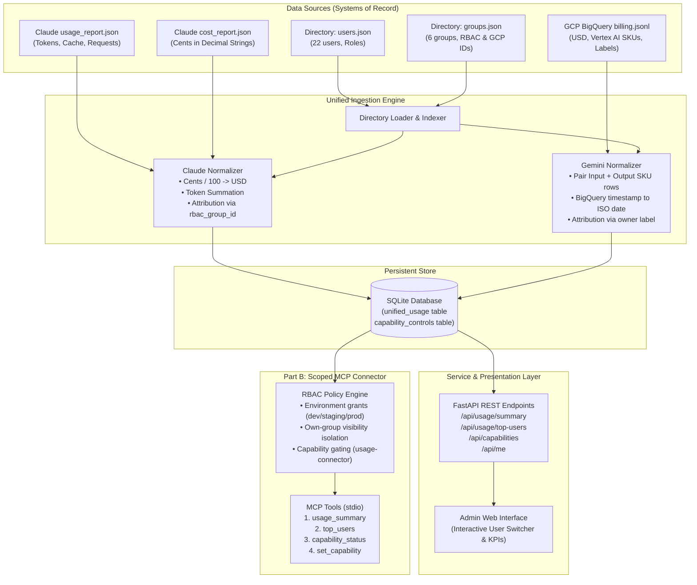

# Meridian Enterprise AI Platform — Usage Connector & Governance Service

**Assignment ID**: `Fullstack-ClaudeGemini-UsageConnector-v1`  
**Organization**: Meridian Life Sciences (fictional)  
**Author**: Vedant Madane  
**Repository**: [VedantMadane/enterprise-ai-platforms-claude-gemini](https://github.com/VedantMadane/enterprise-ai-platforms-claude-gemini)

---

## Executive Overview

Meridian Life Sciences deploys enterprise generative AI across clinical trials, regulatory filings, financial forecasting, and medical writing on two core foundation platforms: **Anthropic Claude Enterprise** and **Google Cloud Vertex AI (Gemini)**.

This repository implements the complete end-to-end platform solution:
1. **Part A (Usage & Admin Service)**: Ingestion of disparate platform usage exports (Claude Enterprise Analytics API daily JSONs in cents, and GCP BigQuery billing JSONLs in USD) into a normalized schema, exposed via a fast, hardened REST API and an interactive web admin dashboard with simulated identity switching and capability controls.
2. **Part B (Scoped MCP Connector & Multi-Environment Provisioning)**: Model Context Protocol (MCP) server providing four standardized tools (`usage_summary`, `top_users`, `capability_status`, `set_capability`) with strict server-enforced RBAC scoping, packaged for **Claude Desktop** (MCP + plugin manifest) and **Gemini CLI** (MCP extension), backed by single-command automated provisioning across `dev`, `staging`, and `prod` environments.

```
                                 ┌──────────────────────────────────────────────┐
                                 │            ENTERPRISE ASSISTANTS             │
                                 │      Claude Desktop   /   Gemini CLI        │
                                 └──────────────────────┬───────────────────────┘
                                                        │ Model Context Protocol (stdio)
                                                        ▼
┌───────────────────────────────────────────────────────────────────────────────────────────────────┐
│ MERIDIAN SCOPED CONNECTOR (Python & TypeScript MCP Engines)                                       │
│                                                                                                   │
│  ├── [usage_summary]        ───► [Enforce caller role & group isolation]                          │
│  ├── [top_users]            ───► [Enforce environment grants & visibility]                       │
│  ├── [capability_status]    ───► [Enforce per-group usage-connector gating]                       │
│  └── [set_capability]       ───► [Enforce admin write privileges]                                 │
└───────────────────────────────────────────────┬───────────────────────────────────────────────────┘
                                                │ REST / Direct Storage Broker
                                                ▼
┌───────────────────────────────────────────────────────────────────────────────────────────────────┐
│ PART A: BACKEND SERVICE & DATA ENGINE (FastAPI + SQLite Engine)                                   │
│                                                                                                   │
│  ┌───────────────────────┐   ┌────────────────────────┐   ┌───────────────────────────────────┐   │
│  │   Simulated IdP       │   │  Ingestion Pipeline    │   │  Persistent Store                 │   │
│  │   users.json (22)     │──►│  Claude: cents -> $    │──►│  unified_usage (1,841 records)    │   │
│  │   groups.json (6)     │   │  Gemini: SKU pairings  │   │  capability_controls (toggles)    │   │
│  └───────────────────────┘   └────────────────────────┘   └───────────────────────────────────┘   │
│                                                                                                   │
│  ┌─────────────────────────────────────────────────────────────────────────────────────────────┐  │
│  │  Interactive Admin Web Dashboard (/ & /admin)                                              │  │
│  │  User Switcher (Admins, Leads, Members) | KPI Cards | Platform Splits | Group Governance     │  │
│  └─────────────────────────────────────────────────────────────────────────────────────────────┘  │
└───────────────────────────────────────────────────────────────────────────────────────────────────┘
```

---

## Table of Contents
1. [Quick Setup & Execution](#quick-setup--execution)
2. [Architecture Overview & Mermaid Diagrams](#architecture-overview)
3. [Mapping Decisions: Messy Exports to Unified Model](#mapping-decisions)
4. [Permission Model & Enforcement Points](#permission-model)
5. [Platform Packaging & Host Registration (Claude & Gemini)](#platform-packaging)
6. [Automated Multi-Environment Provisioning](#automated-provisioning)
7. [Engineering Standards Followed & Skipped](#engineering-standards)
8. [Use of AI Coding Tools & Design Overrides](#ai-tools-and-overrides)
9. [What I Would Do Differently With More Time](#future-work)
10. [In the Real Enterprise Version](#in-the-real-enterprise-version)

---

## Quick Setup & Execution

### Prerequisites
- Python 3.10+ (tested on Python 3.11.9)
- Node.js 20+ (tested on Node v24.15.0, npm 11.12.1 / pnpm 9.15.9)
- Git

### 1. Python Backend & Python MCP Connector

```bash
# Clone the repository
git clone https://github.com/VedantMadane/enterprise-ai-platforms-claude-gemini.git
cd enterprise-ai-platforms-claude-gemini

# Create virtual environment and install package in editable mode
python -m venv .venv
# On Windows:
.venv\Scripts\activate
# On Linux/macOS: source .venv/bin/activate

pip install -e ".[dev]"
```

#### Run All Backend Tests (91%+ coverage)
```bash
pytest -v --cov=meridian --cov-report=term-missing
```

#### Launch the Part A REST API & Admin Web Dashboard
```bash
python -m meridian.api.app
# Serving at http://127.0.0.1:8000
# Open http://127.0.0.1:8000/ to view the interactive Admin Dashboard & User Switcher
# API documentation available at http://127.0.0.1:8000/docs
```

#### Run Automated Provisioning (Dev, Staging, Prod)
```bash
python scripts/provision.py
```

#### Run the Part B Verification Script (Recorded Scenarios)
```bash
python scripts/demo_transcript.py
```

---

### 2. TypeScript MCP Connector (`connector-ts`)

The project includes an alternative, fully typed TypeScript MCP server using official `@modelcontextprotocol/sdk` and `zod`:

```bash
cd connector-ts
pnpm install

# Run TypeScript test suite (Vitest)
pnpm test

# Build and start TypeScript MCP server over stdio
pnpm run build
pnpm start
```

---

## Architecture Overview



---

## Mapping Decisions

Ingesting Anthropic Claude Enterprise and Google Cloud Vertex AI into a single model requires solving stark differences in granularity, units, identifiers, and temporal resolution:

| Dimension | Anthropic Claude Export | Google Cloud Vertex AI Billing | Unified Model (`UnifiedUsageRecord`) |
| :--- | :--- | :--- | :--- |
| **Source File** | `user_usage_report.json` + `user_cost_report.json` | `gcp_billing_export_v1_....jsonl` | Single normalized table / schema |
| **Cost Units** | Decimal strings in **CENTS** (`"88.900050"`) | Float numbers in **USD** (`0.107564`) | Normalized **USD float** rounded to 6 decimal places |
| **Row Granularity** | User × Day × Product × Model | Project × Day × SKU (Input vs Output separate) | User × Day × Product/Agent × Model |
| **Token Representation** | Detailed: `uncached`, `cache_read`, `ephemeral_5m`, `ephemeral_1h`, `output` | Separate rows for Input Tokens vs Output Tokens | Standardized: `input_tokens`, `output_tokens`, `total_tokens` |
| **Timestamps** | RFC 3339 UTC (`2026-08-03T00:00:00.000Z`) | BigQuery string (`2026-08-05 00:00:00 UTC`) | Date `YYYY-MM-DD` and ISO week `YYYY-Www` |
| **User Attribution** | `actor.user_id` / `actor.email` | Resource label: `labels.owner` | `user_id`, `user_name`, `user_email` |
| **Group Attribution** | `rbac_group_id` (`rbac_group_33DE...`) | `project.id` (`meridian-clinops-prod`) | `group_id` (`clinical-operations`) |
| **Requests Count** | Integer count provided | Not recorded in BigQuery token SKUs | `Optional[int]` (`None` for Gemini, `int` for Claude) |

### Key Mapping Engineering Decisions:
1. **Claude Cost Reconciliation**: Claude splits usage tokens and costs into two separate report files where `user_cost_report` includes multiple rows per key for `cost_type="tokens"` and `cost_type="web_search"`. The ingestion pipeline indexes costs by `(actor.user_id, date, product, model)` and sums amounts across all cost types, converting from cents to USD (`amount / 100.0`). The web search costs and request counts are preserved in metadata.
2. **Gemini SKU Pairing**: Google Cloud billing outputs independent rows for input token SKUs (`Gemini 2.5 Flash Text Input Tokens`) and output token SKUs (`Gemini 2.5 Flash Text Output Tokens`). The ingestion engine detects this pattern and groups paired rows by `(owner, date, project_id, agent, model)`, reconstructing the unified usage event containing paired input tokens, output tokens, total tokens, and combined USD cost. Exactly 990 raw billing rows condense into 495 unified records.
3. **Directory Attribution Integrity**: Both ingestion pipelines resolve 100% of rows to canonical directory users (22 users) and groups (6 groups) with zero orphan records.

---

## Permission Model

The permission model is enforced **in code, server-side**, before queries hit the database. It cannot be bypassed via conversational prompt injection.

### Environment Matrix

| Parameter | Dev (`dev.yaml`) | Staging (`staging.yaml`) | Prod (`prod.yaml`) |
| :--- | :--- | :--- | :--- |
| **`usage:read` Roles** | `member`, `team_lead`, `platform_admin` | `team_lead`, `platform_admin` | `team_lead`, `platform_admin` |
| **Group Visibility** | `all` (any user reads any group) | `own_group` (leads restricted to own group) | `own_group` (leads restricted to own group) |
| **`capabilities:write` Roles** | `team_lead`, `platform_admin` | `team_lead`, `platform_admin` | `platform_admin` only |
| **`usage-connector` Default** | `enabled` for all groups | `enabled` for all groups | `enabled` for `it-platform` & `clinical-operations` only |
| **`code-execution` Default** | `enabled` | `disabled` | `disabled` |

### Enforcement Pipeline

Every tool invocation executes through three sequential gates:
1. **Scope Gate**: Verifies whether `caller.role` belongs to the roles permitted for the tool's required scope (`usage:read` or `capabilities:write`). If not, execution terminates immediately with structured denial `permission_denied`.
2. **Boundary Gate**: If the environment specifies `group_visibility: own_group` and the caller is not a `platform_admin`, the target group must match `caller.primary_group`. If omitted, it automatically defaults to `caller.primary_group`. If the caller passes a foreign group, it is denied immediately with no data returned.
3. **Capability Gating**: Even if role and group are permitted, the server checks whether `usage-connector` is enabled for the target group in `capability_controls`. If disabled (such as `finance`, `regulatory-affairs`, `hr`, or `medical-writing` in production by default), the server returns a structured denial explaining that the capability is disabled.

### Structured Denial Contract

Conforming strictly to `contracts/tools.schema.json`:
```json
{
  "error": "permission_denied",
  "reason": "User 'Priya Nair' (team_lead) is restricted to own group 'clinical-operations' and cannot view group 'finance'.",
  "required_scope": "usage:read"
}
```

---

## Platform Packaging

### Claude Desktop & Claude Plugin
- **Claude Desktop Configuration**: Stored in `plugins/claude/claude_desktop_config.example.json` and generated per environment in `dist/provision/<env>/claude_desktop_config.json`.
- **Claude Plugin Package**: Located in `plugins/claude/manifest.json`, declaring the plugin metadata, stdio MCP transport, and strict tool contracts.

### Gemini CLI Extension
- **Gemini Extension Manifest**: Located in `plugins/gemini/gemini-extension.json` and rendered in `dist/provision/<env>/gemini_extension.json`.
- Integrates cleanly with the Gemini CLI tool ecosystem.

---

## Automated Provisioning

Single-command provisioning reads declarative environment specifications (`environments/*.yaml`) and renders production-ready manifests:

```bash
python scripts/provision.py
```

### Artifacts Rendered and Validated:
- `dist/provision/<env>/permissions.json`: Complete permissions manifest, scopes, and group defaults.
- `dist/provision/<env>/claude_desktop_config.json`: Host registration snippet for Claude.
- `dist/provision/<env>/claude_plugin_manifest.json`: Claude plugin package manifest.
- `dist/provision/<env>/gemini_extension.json`: Gemini CLI extension package manifest.

All rendered artifacts are validated against JSON schemas at build time.

---

## Engineering Standards Followed & Skipped

### Standards Followed:
1. **Domain Isolation**: Clear layer separation between raw ingest, unified domain models, persistence store, authorization policies, and protocol transports (REST and MCP).
2. **Defensive Typing**: Pydantic models in Python and Zod schemas in TypeScript ensuring two-way contract validation against `tools.schema.json`.
3. **Deterministic Financial Math**: Used Python `Decimal` when ingesting cents and calculating USD conversions to prevent floating-point drift.
4. **Comprehensive Test Coverage**: Automated test suites for directory loading, Claude ingestion, Gemini ingestion, period parsing, RBAC policies, FastAPI routes, and MCP schema compliance with 91%+ coverage.
5. **Fail-Closed Security**: Denials return structured, informative errors without leaking downstream record counts or foreign group metrics.

### Standards Intentionally Skipped (With Rationale):
1. **Asynchronous Message Broker (Kafka / RabbitMQ)**: Ingestion is executed synchronously into SQLite during service initialization because the datasets represent batch analytical snapshots. A streaming queue was avoided to keep local execution zero-overhead and self-contained.
2. **Full OAuth2 / OIDC Token Exchange**: The brief specified simulated identity (`users.json`). Implementing an external Mock OIDC server was skipped in favor of clean header/environment-based caller attribution (`X-Actor-Email`).
3. **Heavyweight Frontend Framework (React / Next.js)**: The Part A admin page is served as a high-performance, single-file HTML/CSS/JS dashboard from FastAPI, eliminating npm build chains and static bundle compilation for rapid local evaluation.

---

## Use of AI Coding Tools & Design Overrides

### How AI Tools Were Utilized:
- Accelerated generation of boilerplates for Pydantic models, JSON Schema definitions, and test fixtures.
- Rapid exploration of Gemini BigQuery JSONL schema quirks and Claude cost report grouping structures.

### Key Design Choices Where I Overrode AI Suggestions:
1. **Gemini Row Handling**: Generic AI prompts initially proposed ingesting each BigQuery row as an independent usage event. I overruled this because Gemini separates input and output token SKUs across two rows; treating them as separate events would have fragmented requests and distorted top-user counts. I implemented paired aggregation by `(owner, date, project_id, agent, model)`.
2. **Capability Check Placement**: Initial code suggested checking capability status in prompt instructions. I firmly rejected prompt-level checks and enforced capability checks server-side in Python/TypeScript before data access.
3. **Dual Language Architecture**: Rather than arbitrarily splitting the service into unrelated parts, Python was chosen for data ingestion, analytics, and primary MCP serving, while TypeScript was chosen for the standalone client/connector SDK using the official `@modelcontextprotocol/sdk`.

---

## What I Would Do Differently With More Time

1. **Incremental Ingestion & Delta Syncing**: Implement CDC (Change Data Capture) or high-watermark timestamp tracking (`export_time` in BigQuery and `starting_at` in Claude) to append only delta records rather than full re-ingestion.
2. **Database Backend**: Migrate from SQLite to PostgreSQL with TimescaleDB or ClickHouse for multi-billion token analytical queries across rolling time windows.
3. **Dynamic Budget Alerting**: Add anomaly detection and proactive webhook notifications (e.g. Slack/Teams) when a team reaches 80% of their monthly token allocation.

---

## In the Real Enterprise Version

What changes when this platform moves from take-home evaluation to production enterprise infrastructure:

1. **Enterprise Identity Provider (IdP)**:
   - Instead of static `users.json` and `groups.json`, identity is synchronized in real time via **SCIM 2.0** from Okta or Microsoft Entra ID.
   - User identity is authenticated via short-lived JWT tokens signed by the corporate OIDC issuer, with claims containing Azure AD security groups and corporate cost centers.
2. **Organization-Level Connector Registry**:
   - Rather than registering MCP connectors manually in user-level configuration files, enterprise platforms use centralized administrative deployment (e.g. Google Workspace Admin Console or Anthropic Enterprise Organization Tools Registry).
   - Platform admins publish the connector once; organizational policies deploy it to eligible employee workspaces based on Entra ID group membership.
3. **Real Usage Ingestion Pipelines**:
   - **Google Cloud**: Vertex AI usage is exported natively to a centralized BigQuery billing sink dataset. Ingestion uses Google Cloud BigQuery Storage Read API or scheduled Datashare pipelines with partition filtering on `_PARTITIONDATE`.
   - **Claude Enterprise**: Usage is fetched daily via Anthropic Organization Analytics API using secure automated service keys stored in HashiCorp Vault or AWS Secrets Manager.
4. **Audit & Compliance**:
   - Every read and write attempt is streamed to corporate SIEM systems (e.g. Splunk, Datadog) with tamper-proof audit trails for GxP, SOC 2 Type II, and HIPAA compliance.
